# Avances del proyecto: de la idea al sistema publicado

Esta carpeta muestra **cómo partió AgeCare y hasta dónde ha llegado**, etapa por etapa, con pantallazos del
programa en cada momento. Sirve como evidencia general de avance (Fase 2) y complementa el historial de
commits del repositorio.

**Equipo:** Bryan Piña Frías y Julio Muñoz Rojas · **Cliente:** Wellq Co. / Alloxentric · **Asignatura:** PTY4614 Capstone

## Cómo se obtuvieron los pantallazos

Los pantallazos de cada etapa son del **programa real de ese momento**: se tomó la versión del código de un commit
del historial (por ejemplo `git checkout d06f581`), se ejecutó en un computador con datos de prueba y se capturó
cada pantalla. Así se puede comprobar la evolución y repetirla. Los datos que cambian con el día (como las
fechas de los listados) corresponden al día de la captura, no al de la etapa.

El estado actual se puede revisar en línea:

| Qué es | Enlace |
|---|---|
| Sitio público (familias y cuidadoras) | <https://bryan-pi-a-julio-munoz-proyecto-de-sigma.vercel.app/> |
| Consola de Administración | <https://bryan-pi-a-julio-munoz-proyecto-de-omega.vercel.app/login> |
| Cuentas de prueba | están en el [README principal](../README.md#revisar-el-proyecto-en-línea) |

## Línea de tiempo

| Fecha | Etapa | Qué se hizo | Quién | Commits |
|---|---|---|---|---|
| 6 sep | 0 · Definición | Se crea el repositorio y se suben las guías de definición del proyecto y la presentación inicial | Bryan | [`93384ab`](https://github.com/Bemol69/BryanPi-a_JulioMunoz_ProyectoDeTitulo_AgecARE/commit/93384ab), [`c073ab7`](https://github.com/Bemol69/BryanPi-a_JulioMunoz_ProyectoDeTitulo_AgecARE/commit/c073ab7) |
| 14 sep | 1 · Primera versión | Consola de Administración y sitio público funcionando, cada uno con su API y su base de datos | Bryan | [`d06f581`](https://github.com/Bemol69/BryanPi-a_JulioMunoz_ProyectoDeTitulo_AgecARE/commit/d06f581) |
| 15–16 sep | 2 · Perfil profesional | Foto de perfil, nueva página de inicio y mejor formulario de perfil profesional de la cuidadora | Julio | [`5c59097`](https://github.com/Bemol69/BryanPi-a_JulioMunoz_ProyectoDeTitulo_AgecARE/commit/5c59097), [`0d4bd98`](https://github.com/Bemol69/BryanPi-a_JulioMunoz_ProyectoDeTitulo_AgecARE/commit/0d4bd98), [`7812e9d`](https://github.com/Bemol69/BryanPi-a_JulioMunoz_ProyectoDeTitulo_AgecARE/commit/7812e9d) |
| 22 sep | 3 · Documentos y panel | Subida de documentos de la cuidadora, panel mejorado, marca «Trabajando» y datos de prueba nuevos | Julio y Bryan | [`fa16547`](https://github.com/Bemol69/BryanPi-a_JulioMunoz_ProyectoDeTitulo_AgecARE/commit/fa16547), [`d8e6218`](https://github.com/Bemol69/BryanPi-a_JulioMunoz_ProyectoDeTitulo_AgecARE/commit/d8e6218) |
| 26 sep | Evidencias de Fase 1 | Autoevaluaciones, diarios de reflexión y guía de definición de cada integrante | Bryan y Julio | [`642fa55`](https://github.com/Bemol69/BryanPi-a_JulioMunoz_ProyectoDeTitulo_AgecARE/commit/642fa55), [`d1eda77`](https://github.com/Bemol69/BryanPi-a_JulioMunoz_ProyectoDeTitulo_AgecARE/commit/d1eda77), [`b25cf91`](https://github.com/Bemol69/BryanPi-a_JulioMunoz_ProyectoDeTitulo_AgecARE/commit/b25cf91), [`6576c4b`](https://github.com/Bemol69/BryanPi-a_JulioMunoz_ProyectoDeTitulo_AgecARE/commit/6576c4b), [`6e4a4db`](https://github.com/Bemol69/BryanPi-a_JulioMunoz_ProyectoDeTitulo_AgecARE/commit/6e4a4db) |
| 2 oct | 4 · Rediseño visual | Nueva imagen con la paleta del logo en el sitio y la Consola; se prepara el despliegue | Bryan | [`1d6cf4a`](https://github.com/Bemol69/BryanPi-a_JulioMunoz_ProyectoDeTitulo_AgecARE/commit/1d6cf4a), [`06341b5`](https://github.com/Bemol69/BryanPi-a_JulioMunoz_ProyectoDeTitulo_AgecARE/commit/06341b5), [`0bd94a0`](https://github.com/Bemol69/BryanPi-a_JulioMunoz_ProyectoDeTitulo_AgecARE/commit/0bd94a0), [`07ecf51`](https://github.com/Bemol69/BryanPi-a_JulioMunoz_ProyectoDeTitulo_AgecARE/commit/07ecf51), [`e4ee92d`](https://github.com/Bemol69/BryanPi-a_JulioMunoz_ProyectoDeTitulo_AgecARE/commit/e4ee92d) |
| 6 oct | Publicación en Vercel | Las cuatro piezas quedan publicadas en Vercel con la base de datos en Supabase | Bryan | [`b56e06c`](https://github.com/Bemol69/BryanPi-a_JulioMunoz_ProyectoDeTitulo_AgecARE/commit/b56e06c), [`058a9a8`](https://github.com/Bemol69/BryanPi-a_JulioMunoz_ProyectoDeTitulo_AgecARE/commit/058a9a8) |
| 12 oct | 5 · Mejoras de la Fase 2 | Ficha del familiar, chat, solicitudes de contratación, revisión de documentos y reseñas, entre otras | Bryan y Julio | [`7891945`](https://github.com/Bemol69/BryanPi-a_JulioMunoz_ProyectoDeTitulo_AgecARE/commit/7891945), [`ddf27a3`](https://github.com/Bemol69/BryanPi-a_JulioMunoz_ProyectoDeTitulo_AgecARE/commit/ddf27a3), [`42cd902`](https://github.com/Bemol69/BryanPi-a_JulioMunoz_ProyectoDeTitulo_AgecARE/commit/42cd902), [`4f569b7`](https://github.com/Bemol69/BryanPi-a_JulioMunoz_ProyectoDeTitulo_AgecARE/commit/4f569b7), [`e9c8b4e`](https://github.com/Bemol69/BryanPi-a_JulioMunoz_ProyectoDeTitulo_AgecARE/commit/e9c8b4e), [`66211ad`](https://github.com/Bemol69/BryanPi-a_JulioMunoz_ProyectoDeTitulo_AgecARE/commit/66211ad), [`7068020`](https://github.com/Bemol69/BryanPi-a_JulioMunoz_ProyectoDeTitulo_AgecARE/commit/7068020), [`7431901`](https://github.com/Bemol69/BryanPi-a_JulioMunoz_ProyectoDeTitulo_AgecARE/commit/7431901) |
| 12–19 oct | Evidencias de Fase 2 | Informe de avance, guías, presentación, capturas y enlaces para revisar el proyecto | Bryan y Julio | [`8f2039b`](https://github.com/Bemol69/BryanPi-a_JulioMunoz_ProyectoDeTitulo_AgecARE/commit/8f2039b), [`86b214d`](https://github.com/Bemol69/BryanPi-a_JulioMunoz_ProyectoDeTitulo_AgecARE/commit/86b214d), [`6e98f25`](https://github.com/Bemol69/BryanPi-a_JulioMunoz_ProyectoDeTitulo_AgecARE/commit/6e98f25), [`66f8802`](https://github.com/Bemol69/BryanPi-a_JulioMunoz_ProyectoDeTitulo_AgecARE/commit/66f8802), [`40443dc`](https://github.com/Bemol69/BryanPi-a_JulioMunoz_ProyectoDeTitulo_AgecARE/commit/40443dc) |

El detalle de cada cambio del sistema, con su fecha, está en [`Registro de cambios/`](../Registro%20de%20cambios/).
El aporte de cada integrante está en [`Fase 2/Aporte del equipo.md`](../Fase%202/Aporte%20del%20equipo.md).

---

## Etapa 0 · Definición del proyecto (6 de septiembre)

Antes de programar se definió **qué se iba a construir**: dentro de la Consola de Administración de AgeCare
(plataforma de cuidado de adultos mayores de Wellq Co.), un marketplace de cuidadoras con un sistema de
fidelización por puntos y ranking. Se acordaron seis endpoints (dos que ya existían y cuatro nuevos), las
competencias del perfil de egreso que se pondrían en práctica y el plan de trabajo en sprints.

<table>
<tr><td align="center" valign="top"><a href="capturas/00_2026-09-06_definicion_del_proyecto/presentacion_01_portada.png">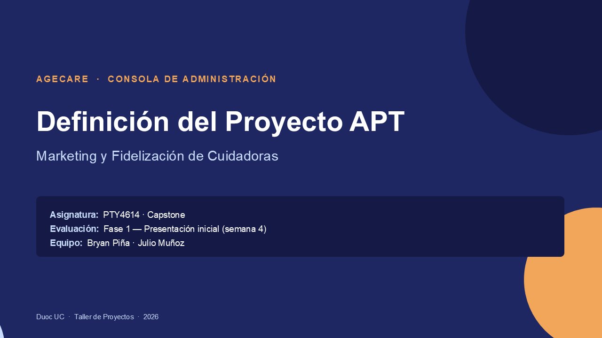</a> Presentación de definición del proyecto</td><td align="center" valign="top"><a href="capturas/00_2026-09-06_definicion_del_proyecto/presentacion_02_relevancia.png">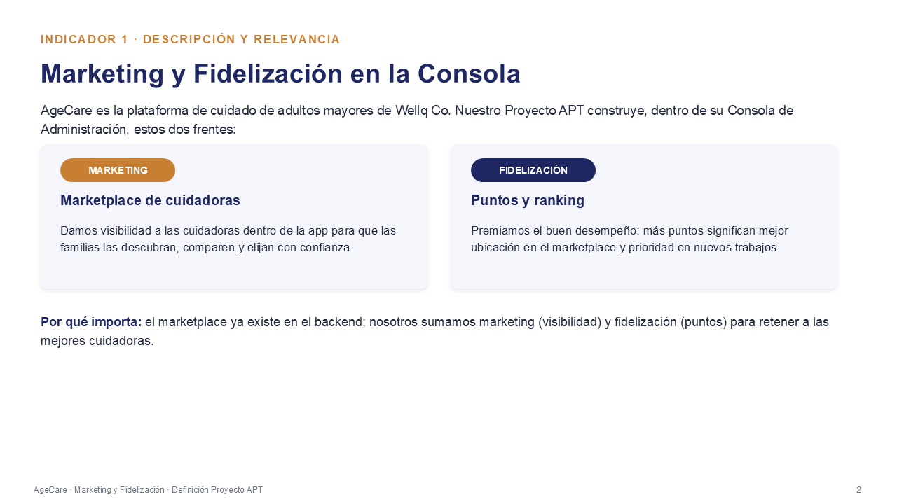</a> Qué es el proyecto: marketing y fidelización</td></tr>
<tr><td align="center" valign="top"><a href="capturas/00_2026-09-06_definicion_del_proyecto/presentacion_03_endpoints_propuestos.png">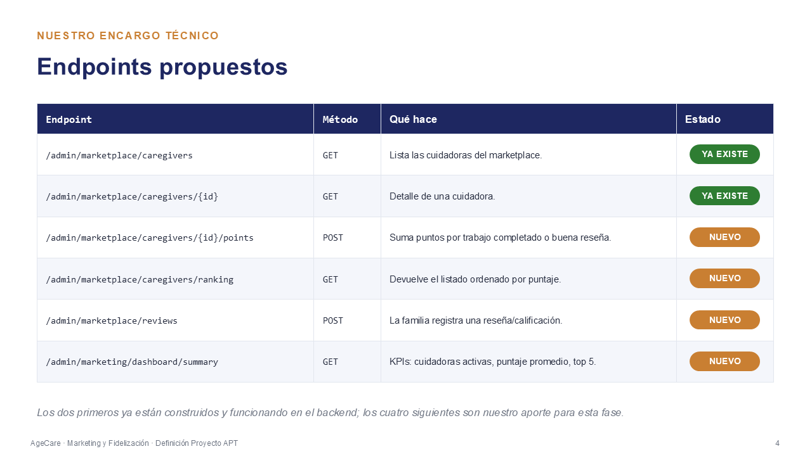</a> Los seis endpoints propuestos</td><td align="center" valign="top"><a href="capturas/00_2026-09-06_definicion_del_proyecto/presentacion_04_competencias.png">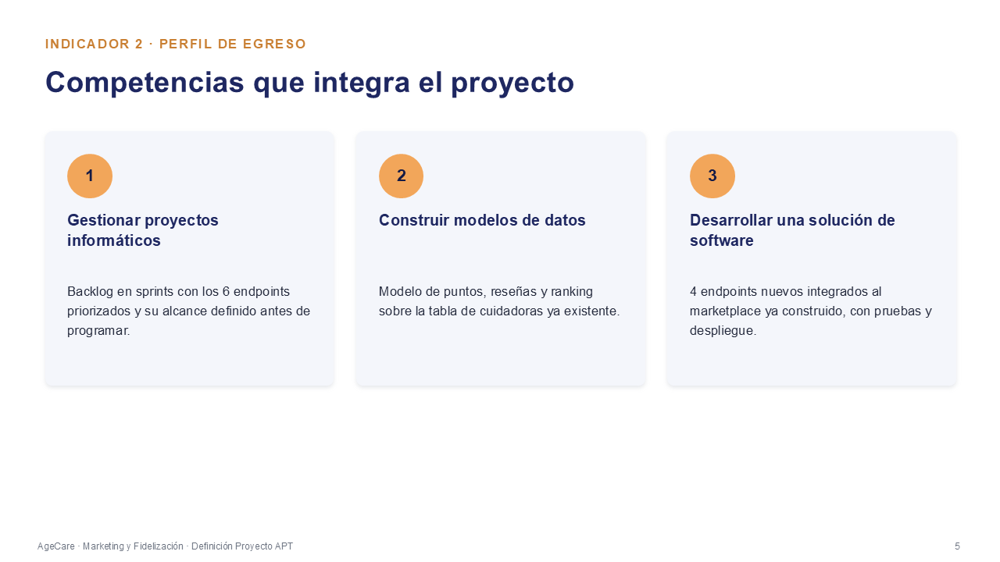</a> Competencias del perfil de egreso que integra</td></tr>
</table>

---

## Etapa 1 · Primera versión funcionando (14 de septiembre)

El 14 de septiembre se subió la primera versión del sistema: **dos aplicaciones**, cada una con su API (FastAPI) y
su base de datos (PostgreSQL), que se comunican entre sí.

- **Consola de Administración:** marketplace de cuidadoras con aprobación de perfiles, *Fidelización y ranking*
  (indicadores, ranking por puntos y registro de reseñas), y las vistas de uso comercial, estado operativo,
  usuarios y soporte, curación de contenido y moderación.
- **Sitio público:** página de inicio, registro e inicio de sesión, búsqueda de cuidadoras para las familias y
  perfil profesional para las cuidadoras.

Visualmente era una primera versión funcional, con colores verde azulado y fondo claro.

<table>
<tr><td align="center" valign="top"><a href="capturas/01_2026-09-14_primera_version/sitio_01_inicio.png">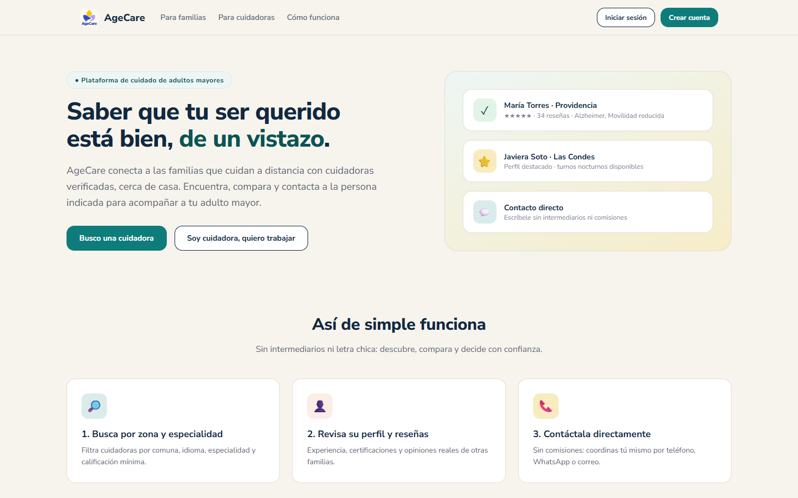</a> Sitio público: página de inicio</td><td align="center" valign="top"><a href="capturas/01_2026-09-14_primera_version/sitio_05_familia_buscar_cuidadoras.png">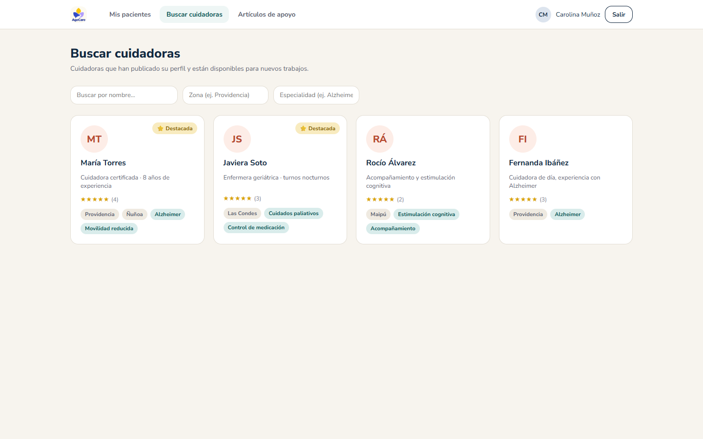</a> Sitio público: búsqueda de cuidadoras (familia)</td></tr>
<tr><td align="center" valign="top"><a href="capturas/01_2026-09-14_primera_version/sitio_07_cuidadora_perfil_profesional.png">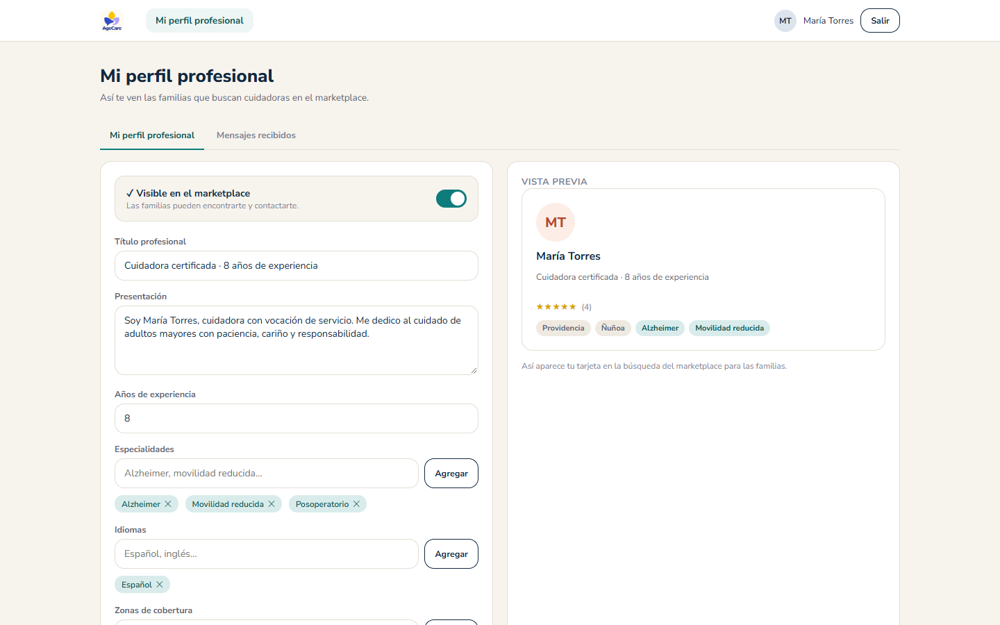</a> Sitio público: perfil profesional (cuidadora)</td><td align="center" valign="top"><a href="capturas/01_2026-09-14_primera_version/consola_02_marketplace_cuidadoras.png">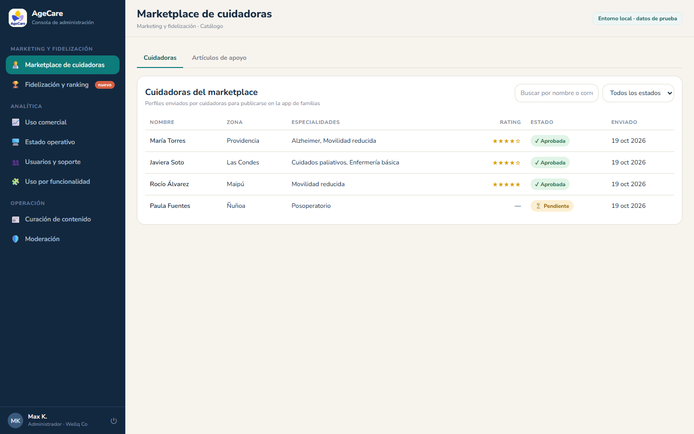</a> Consola: marketplace de cuidadoras</td></tr>
<tr><td align="center" valign="top"><a href="capturas/01_2026-09-14_primera_version/consola_03_fidelizacion_ranking.png">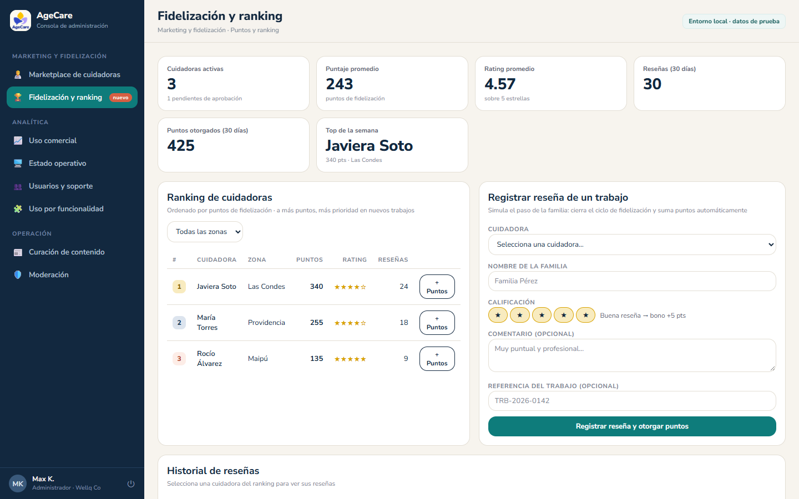</a> Consola: fidelización y ranking</td><td align="center" valign="top"><a href="capturas/01_2026-09-14_primera_version/consola_04_uso_comercial.png">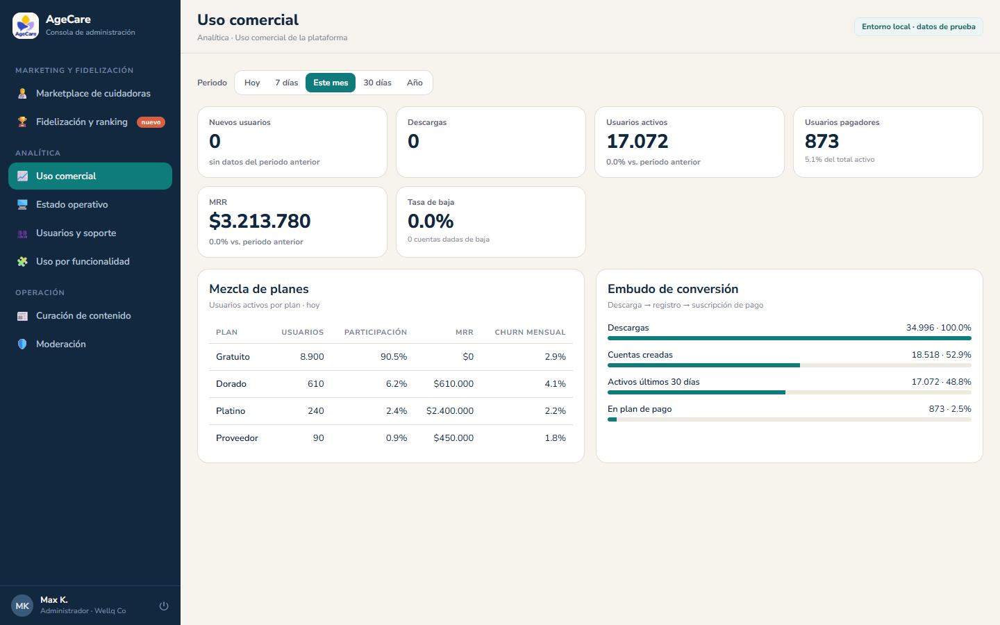</a> Consola: uso comercial</td></tr>
</table>

---

## Etapa 2 · Perfil profesional y foto de perfil (15 y 16 de septiembre)

Se trabajó la parte de la cuidadora en el sitio público: se agregó la **foto de perfil**, se rediseñó la
**página de inicio** y se mejoró el **formulario del perfil profesional**, que ahora muestra una vista previa de
cómo verán su tarjeta las familias. Parte de estos cambios también se reflejan en la Consola, que recibe el perfil
publicado para su revisión.

<table>
<tr><td align="center" valign="top"><a href="capturas/02_2026-09-16_perfil_profesional_y_foto/sitio_01_inicio.png">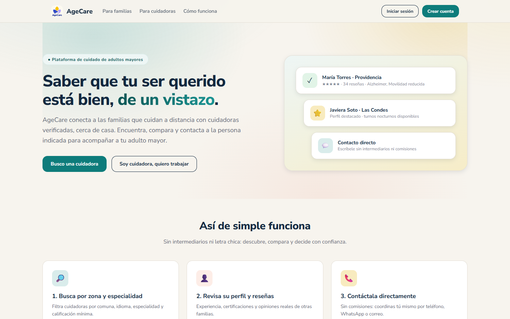</a> Página de inicio rediseñada</td><td align="center" valign="top"><a href="capturas/02_2026-09-16_perfil_profesional_y_foto/sitio_07_cuidadora_perfil_profesional.png">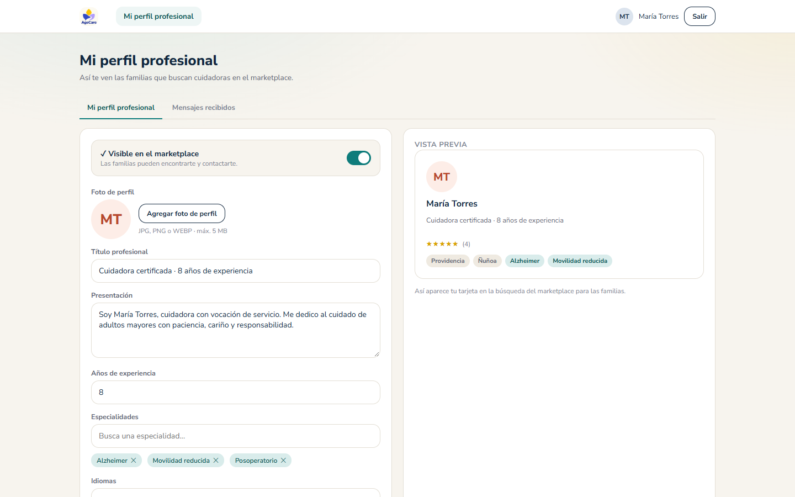</a> Perfil profesional con foto y vista previa</td></tr>
<tr><td align="center" valign="top"> Búsqueda de cuidadoras</td><td align="center" valign="top"> Consola: marketplace de cuidadoras</td></tr>
</table>

---

## Etapa 3 · Documentos y panel de la cuidadora (22 de septiembre)

La cuidadora pudo **subir sus documentos** (cédula de identidad, certificado de antecedentes y certificados de
cursos), y su perfil pasó a mostrarse como una ficha con el botón *Editar perfil*. También se agregó la marca
**«Trabajando»** y la información de con qué familia trabaja, junto con datos de prueba más completos. En la
Consola, el equipo empezó a ver los documentos de cada cuidadora.

<table>
<tr><td align="center" valign="top"><a href="capturas/03_2026-09-22_documentos_y_panel_cuidadoras/sitio_07_cuidadora_perfil_profesional.png">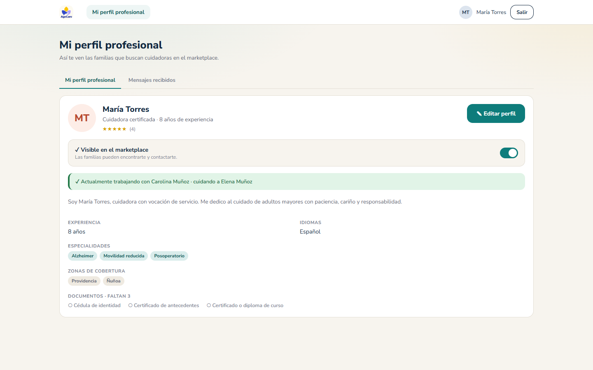</a> Panel de la cuidadora: ficha, trabajo actual y documentos</td><td align="center" valign="top"> Panel de la cuidadora (página completa)</td></tr>
<tr><td align="center" valign="top"><a href="capturas/03_2026-09-22_documentos_y_panel_cuidadoras/sitio_05_familia_buscar_cuidadoras.png">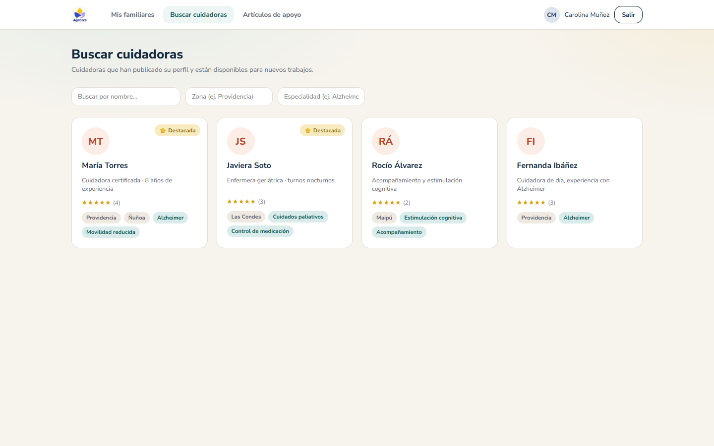</a> Búsqueda de cuidadoras</td><td align="center" valign="top"><a href="capturas/03_2026-09-22_documentos_y_panel_cuidadoras/consola_02_marketplace_cuidadoras.png">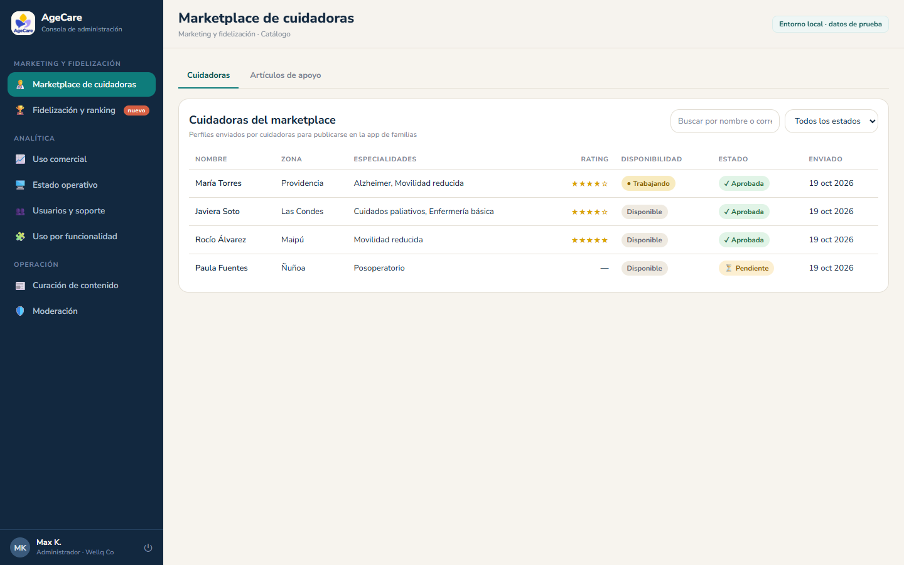</a> Consola: marketplace de cuidadoras</td></tr>
</table>

---

## Etapa 4 · Rediseño visual y preparación para publicar (2 de octubre)

Se renovó toda la imagen del sistema usando la **paleta de colores del logo** y un estilo más moderno (degradados,
tarjetas, animaciones suaves), tanto en el sitio público como en la Consola. Ese mismo día se prepararon los
cuatro proyectos para publicarse en Vercel, con la base de datos y los archivos en Supabase. El 6 de octubre se
corrigieron los últimos problemas de despliegue y el sistema quedó **publicado en internet**.

<table>
<tr><td align="center" valign="top"> Página de inicio con la nueva imagen</td><td align="center" valign="top"><a href="capturas/04_2026-10-02_rediseno_visual/sitio_07_cuidadora_perfil_profesional.png">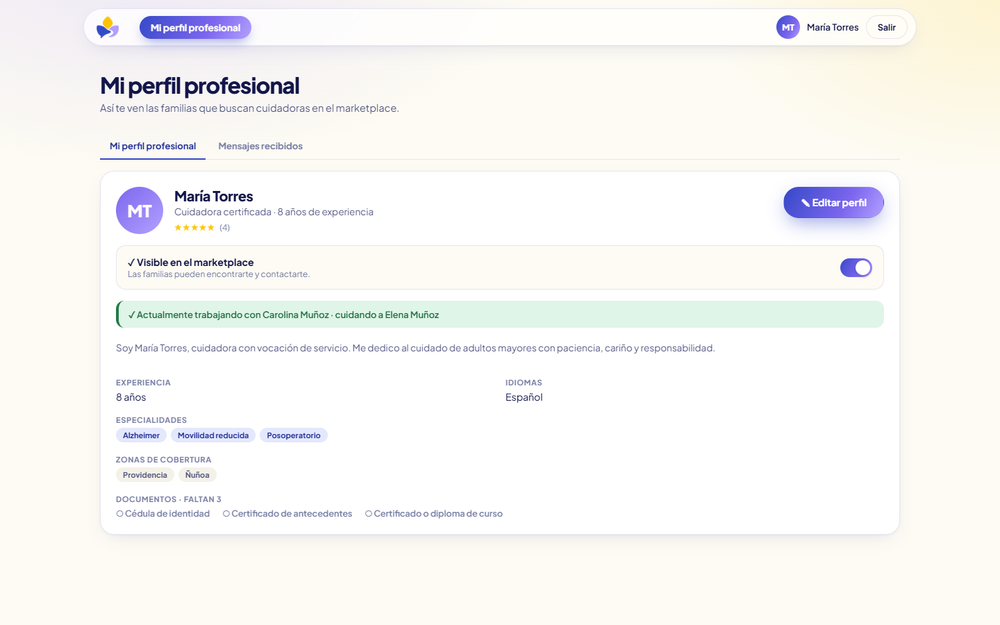</a> Panel de la cuidadora</td></tr>
<tr><td align="center" valign="top"><a href="capturas/04_2026-10-02_rediseno_visual/sitio_05_familia_buscar_cuidadoras.png">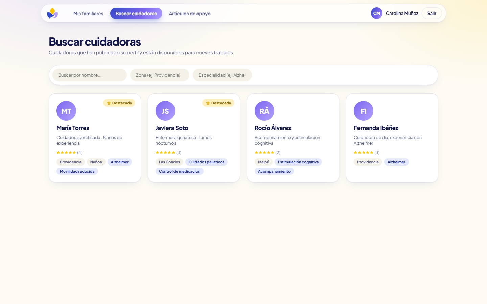</a> Búsqueda de cuidadoras</td><td align="center" valign="top"> Consola: fidelización y ranking</td></tr>
</table>

---

## Etapa 5 · Mejoras de la Fase 2 (12 de octubre)

Es la etapa con más cambios. Los principales, todos registrados con fecha en el
[Registro de cambios](../Registro%20de%20cambios/):

- **Ficha del familiar** con su estado de cuidado, y tarjetas de cuidadoras con la marca «Trabajando».
- **Chat** entre familia y cuidadora; los mensajes se eliminan a los 7 días y la persona recibe un aviso.
- **Solicitudes de contratación** en lugar de contratación directa: la cuidadora puede aceptarlas o rechazarlas,
  y solo puede tener un trabajo activo a la vez.
- **Reseñas** únicamente cuando el trabajo terminó; la cuidadora ya puede ver las que recibe.
- **Documentos con aprobación del equipo:** la cuidadora ve el estado de cada archivo, el equipo los aprueba o
  rechaza desde la Consola, y un perfil no aparece en el marketplace hasta ser aprobado. Los perfiles suspendidos
  se ocultan y se pueden reactivar.
- Sincronización entre ambos sistemas para que los estados no queden distintos, e insignia de cuidadora verificada
  con indicador de perfil completo.

<table>
<tr><td align="center" valign="top"><a href="capturas/05_2026-10-12_mejoras_de_la_fase_2/sitio_01_inicio.png">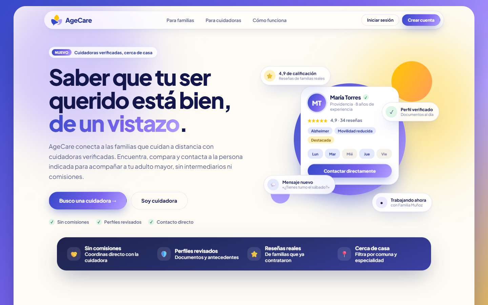</a> Sitio público: página de inicio</td><td align="center" valign="top"><a href="capturas/05_2026-10-12_mejoras_de_la_fase_2/sitio_05_familia_buscar_cuidadoras.png">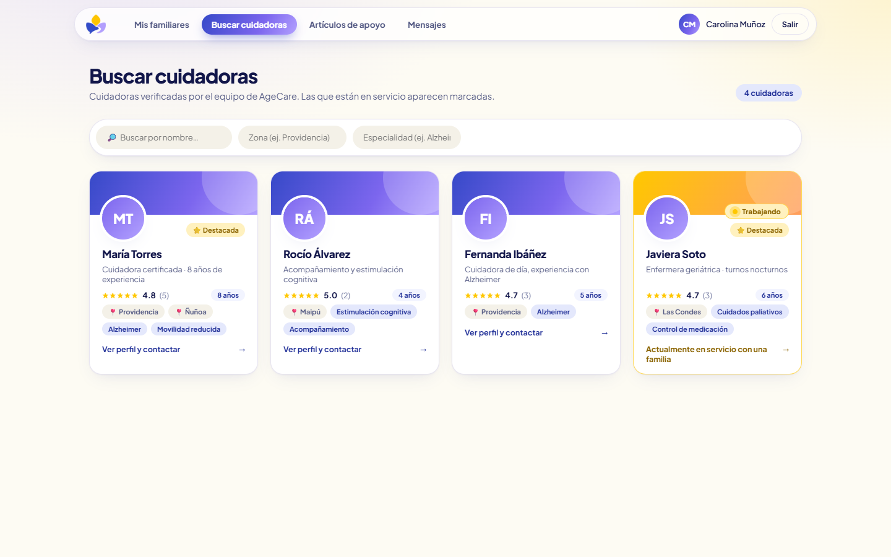</a> Familia: búsqueda de cuidadoras (marca «Trabajando»)</td></tr>
<tr><td align="center" valign="top"><a href="capturas/05_2026-10-12_mejoras_de_la_fase_2/sitio_06_familia_perfil_cuidadora.png">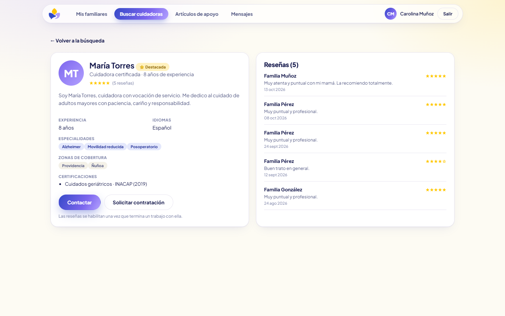</a> Familia: perfil de la cuidadora con reseñas y solicitud</td><td align="center" valign="top"><a href="capturas/05_2026-10-12_mejoras_de_la_fase_2/sitio_08_chat_familia_cuidadora.png">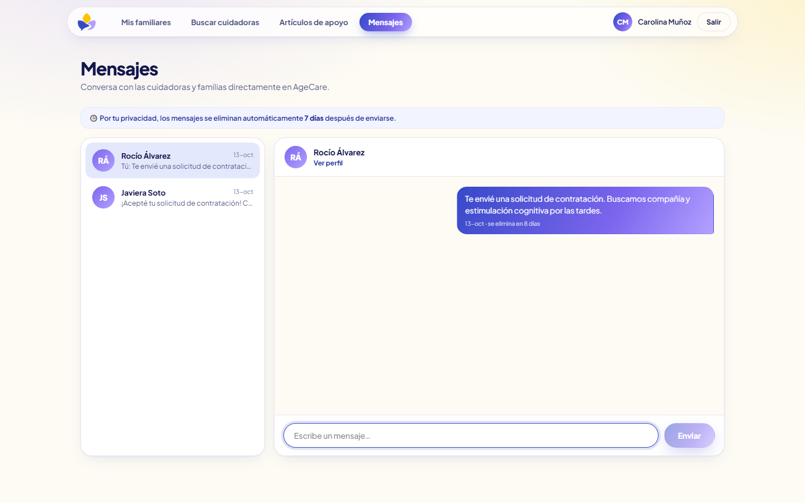</a> Chat entre familia y cuidadora</td></tr>
<tr><td align="center" valign="top"><a href="capturas/05_2026-10-12_mejoras_de_la_fase_2/sitio_10_familia_ficha_del_familiar.png">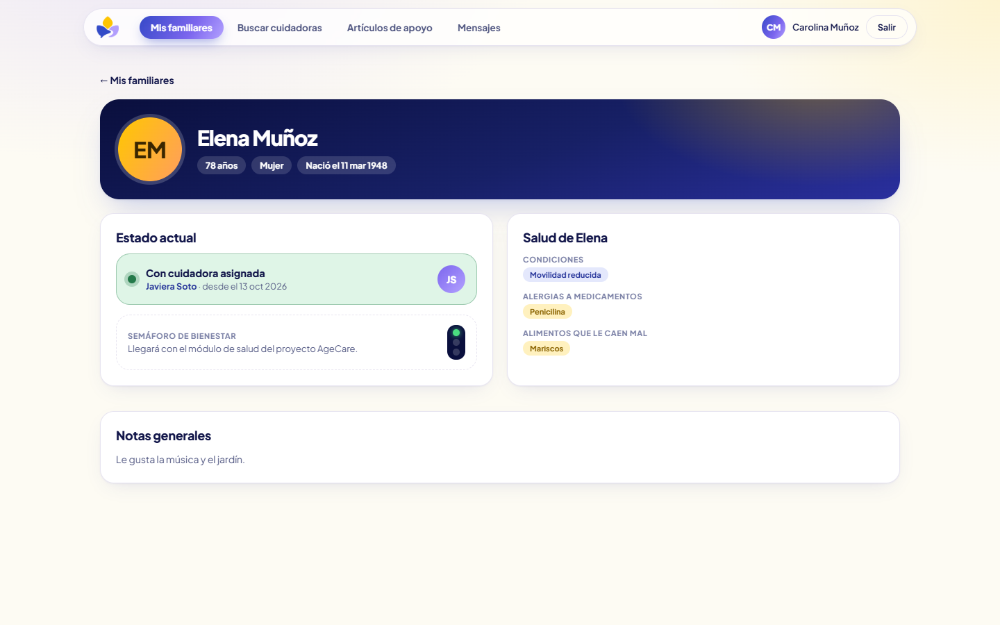</a> Familia: ficha del adulto mayor</td><td align="center" valign="top"><a href="capturas/05_2026-10-12_mejoras_de_la_fase_2/sitio_09_cuidadora_solicitudes.png">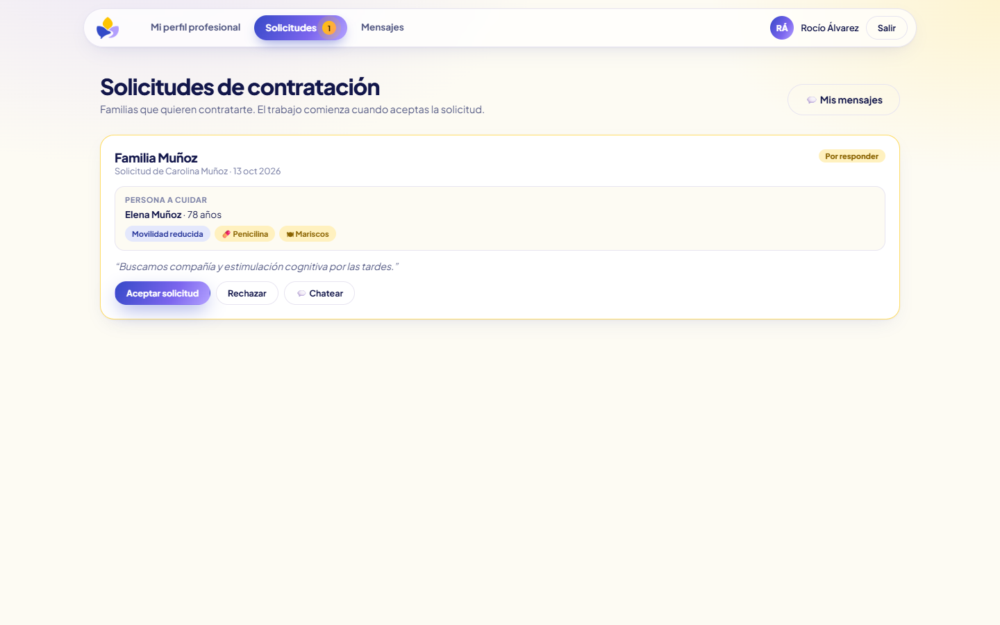</a> Cuidadora: solicitud de contratación</td></tr>
<tr><td align="center" valign="top"><a href="capturas/05_2026-10-12_mejoras_de_la_fase_2/sitio_07_cuidadora_perfil_profesional.png">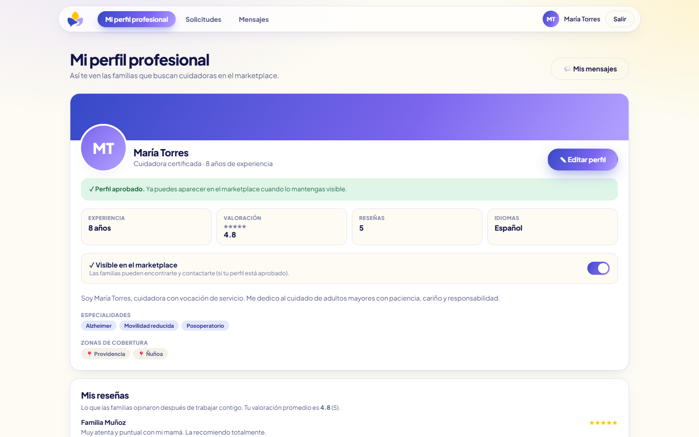</a> Cuidadora: perfil profesional</td><td align="center" valign="top"><a href="capturas/05_2026-10-12_mejoras_de_la_fase_2/sitio_11_cuidadora_documentos.png">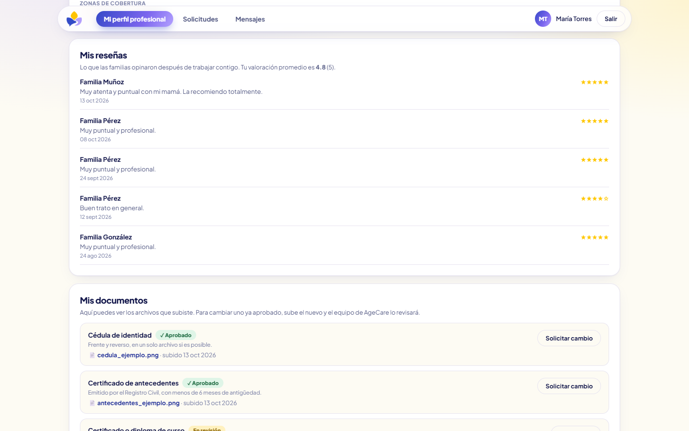</a> Cuidadora: documentos y su estado de revisión</td></tr>
<tr><td align="center" valign="top"><a href="capturas/05_2026-10-12_mejoras_de_la_fase_2/sitio_12_cuidadora_mis_resenas.png">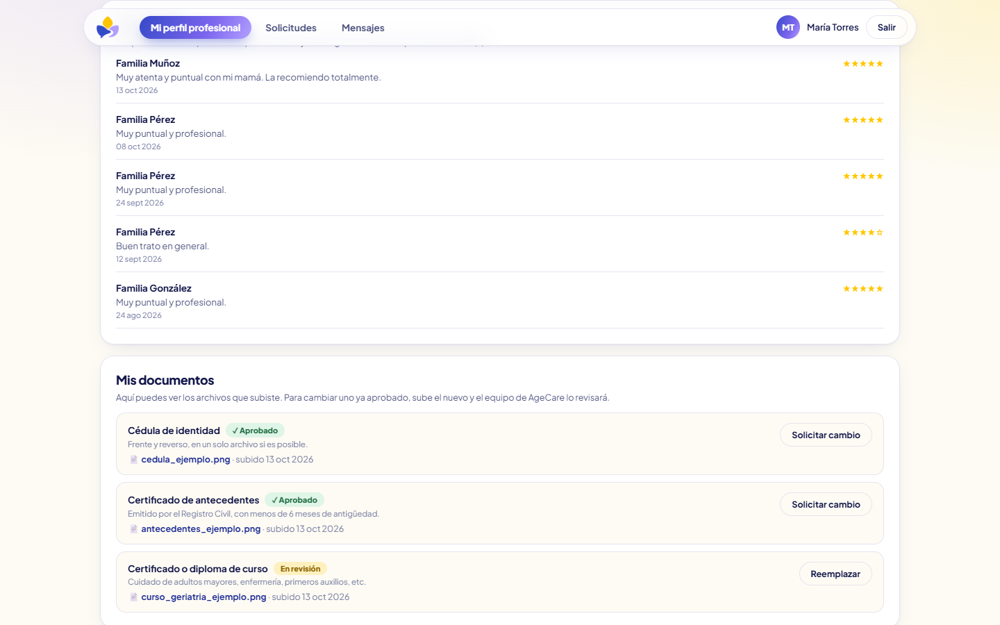</a> Cuidadora: reseñas que ha recibido</td><td align="center" valign="top"><a href="capturas/05_2026-10-12_mejoras_de_la_fase_2/consola_02_marketplace_cuidadoras.png">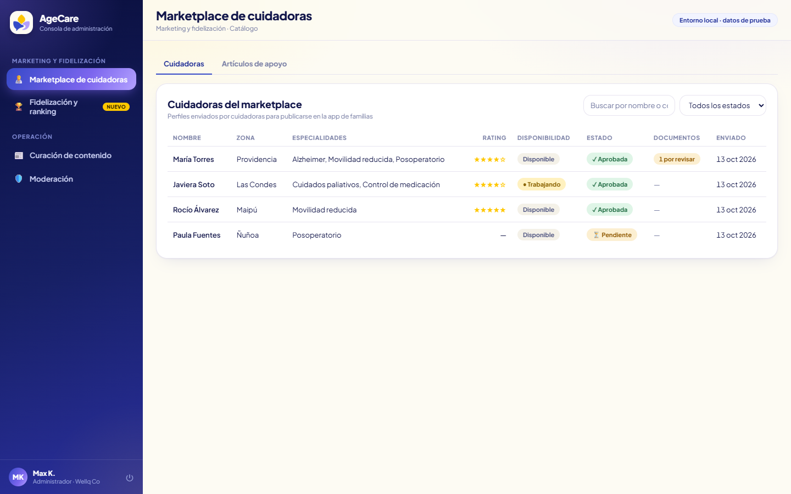</a> Consola: marketplace de cuidadoras</td></tr>
<tr><td align="center" valign="top"><a href="capturas/05_2026-10-12_mejoras_de_la_fase_2/consola_05_revision_de_documentos.png">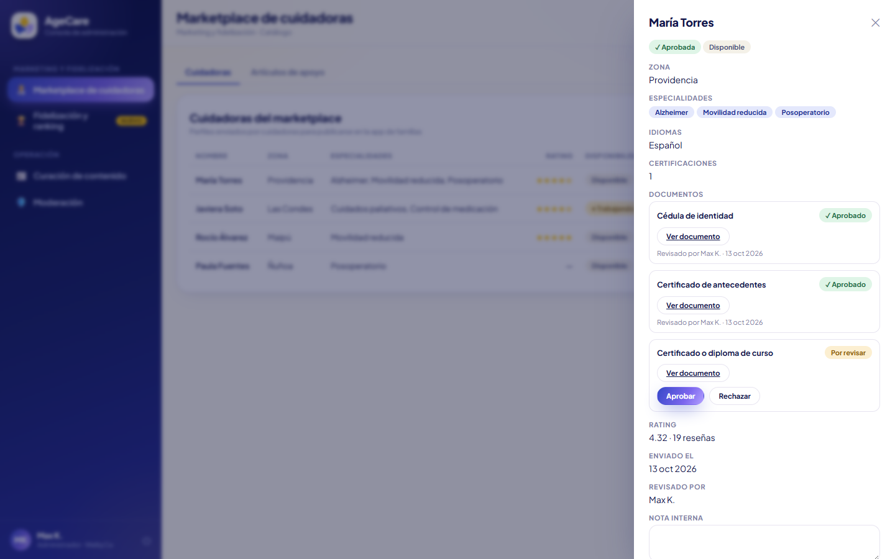</a> Consola: revisión de documentos</td><td align="center" valign="top"><a href="capturas/05_2026-10-12_mejoras_de_la_fase_2/consola_03_fidelizacion_ranking.png">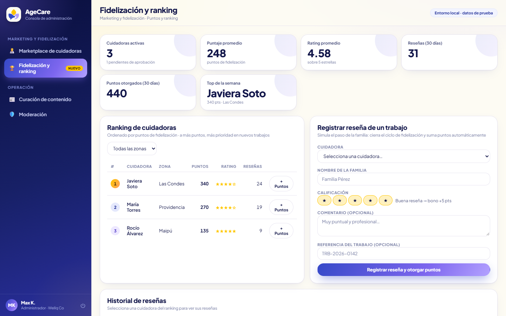</a> Consola: fidelización y ranking</td></tr>
</table>

---

## Qué cambió de la primera versión a hoy

| Aspecto | 14 de septiembre | Hoy |
|---|---|---|
| Publicación | Solo en computadores del equipo (Docker) | Publicado en Vercel, con base de datos en Supabase y despliegue automático |
| Imagen | Primera versión funcional | Rediseño completo con la paleta del logo |
| Contratación | Contacto directo | Solicitud que la cuidadora acepta o rechaza, con chat |
| Perfiles de cuidadoras | Aprobación del perfil | Aprobación del perfil y de sus documentos por el equipo, con suspensión y reactivación |
| Reseñas | Registro de reseñas en la Consola | Reseñas del sitio solo al terminar un trabajo, visibles para la cuidadora |
| Pruebas | 23 pruebas automáticas en la Consola (autenticación, métricas y soporte) | 50 pruebas automáticas (30 de la Consola y 20 del sitio) y documentación Swagger de ambas APIs |
